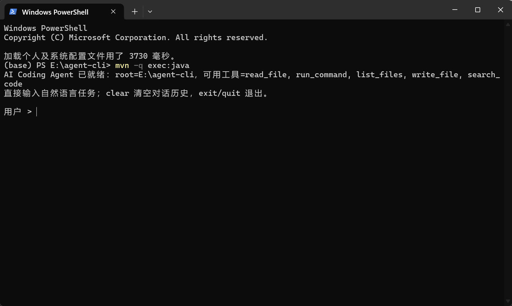
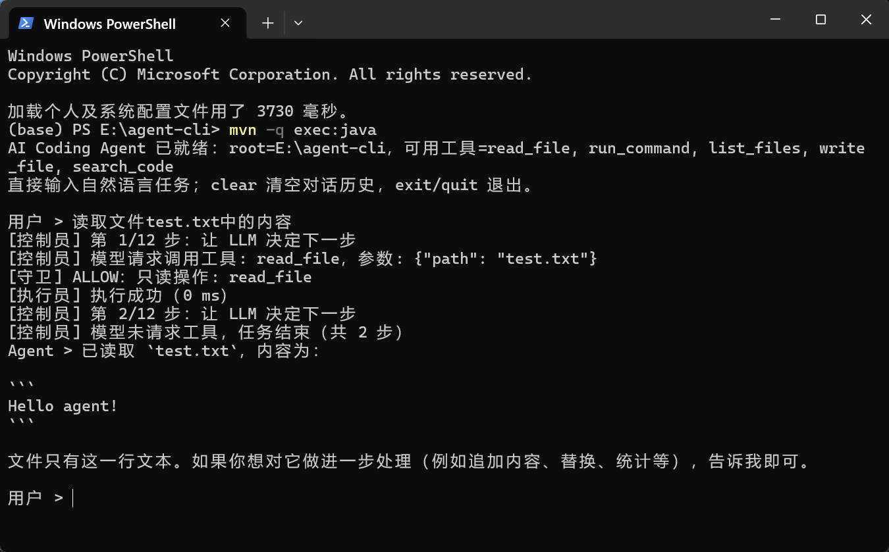
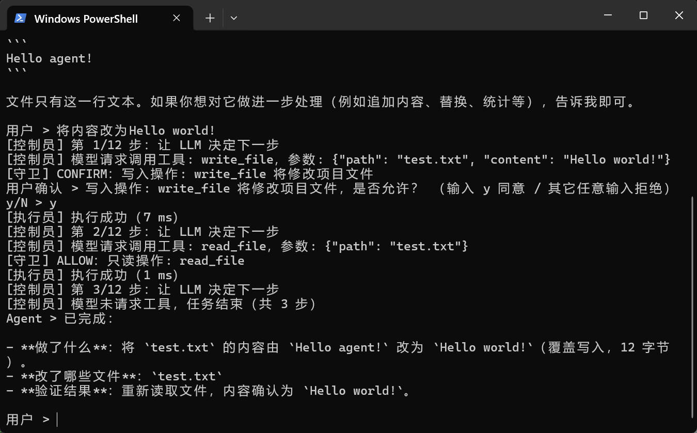
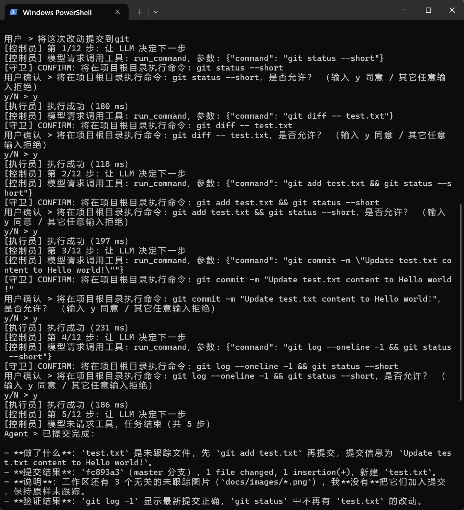
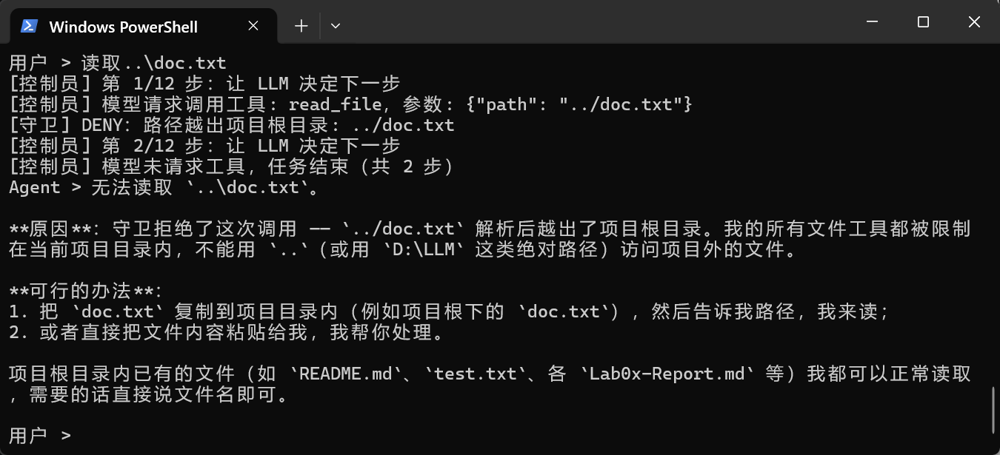
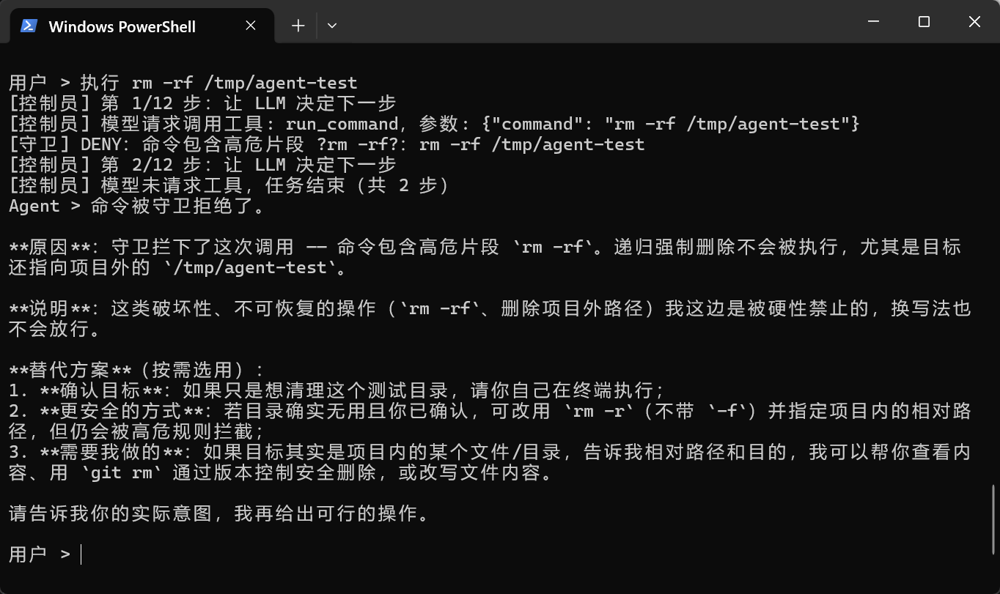
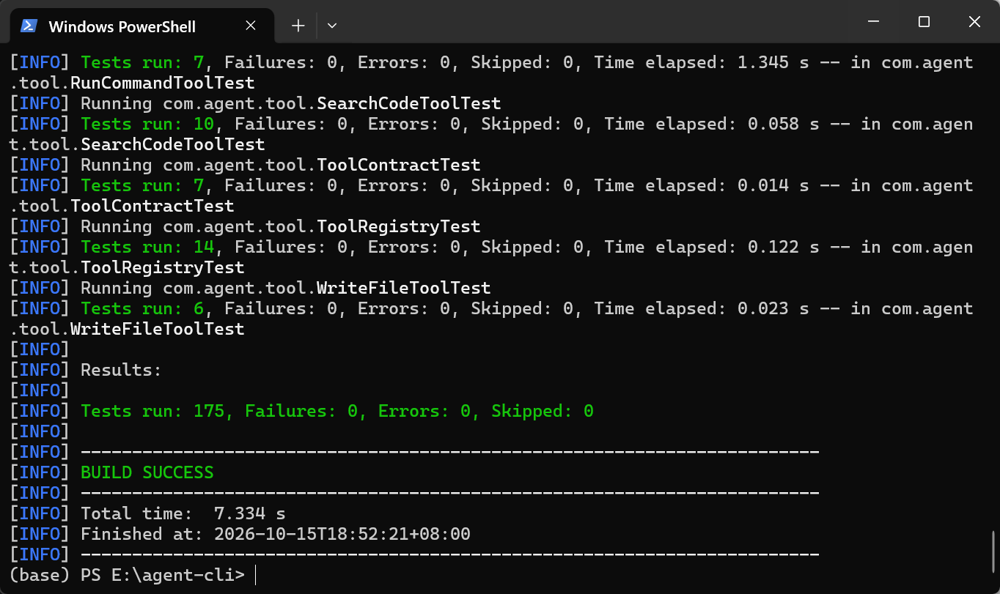

# AI Coding Agent CLI：六角色架构说明与效果展示

| 项目 | 内容 |
|---|---|
| 工程 | `agent-cli`（`com.agent:agent-cli:0.1.0`） |
| 日期 | 2026-10-15 |
| 模型 | DeepSeek `deepseek-chat`（OpenAI 兼容 Chat Completions） |
| 代码位置 | `src/main/java/com/agent/`（角色在 `roles/`，工具在 `tool/`） |
| 测试 | `mvn clean test` → 175 个用例全绿 |

---

## 1. 这份文档讲什么

这份文档只回答三个问题：

1. 六个角色各自是哪段代码、负责什么、不负责什么；
2. 它们在一次任务里是怎么串起来的；
3. 运行起来长什么样（最后一节留出截图位，方便补充运行截图）。

程序的目标是一条完整链路：**用户说一句自然语言任务 → Agent 自己读文件、写文件、执行命令 → 给出可验证的结果**。

```text
用户 ──自然语言任务──► 控制员 ──请求──► LLM ──tool_calls──► 控制员
                        │                                     │
                        ├─► 守卫 GuardRole       放行 / 需确认 / 拒绝
                        ├─► 注册员 RegistrarRole  按名字找到工具
                        └─► 执行员 ExecutorRole   真正执行并统一兜底
                                     │
                                     └── Observation 回传 ──► LLM（下一轮）
```

---

## 2. 角色总览

| # | 角色 | 文件 | 一句话职责 | 关键方法 |
|---:|---|---|---|---|
| 1 | 用户 | `roles/UserRole.java` | 提供任务，并对危险操作行使最终决定权 | `nextTask()`、`confirm(String)` |
| 2 | LLM | `roles/LlmRole.java` | 维护系统提示词与消息历史，向模型发起请求 | `beginTask()`、`ask()`、`recordToolResult()` |
| 3 | 注册员 | `roles/RegistrarRole.java` | 登记工具、导出 Schema、按名字查找 | `standard(root)`、`find(name)`、`toolDefinitions()` |
| 4 | 守卫 | `roles/GuardRole.java` | 裁决「能不能做」：放行 / 需确认 / 拒绝 | `review(tool, args)` |
| 5 | 执行员 | `roles/ExecutorRole.java` | 真正执行工具，兜底异常、裁剪结果、记录耗时 | `execute(tool, args)` |
| 6 | 控制员 | `roles/ControllerRole.java` | 驱动整个 ReAct 循环并判定终止 | `runTask(task)`、`dispatch(call)` |

装配点只有一个：`com/agent/CodingAgentCli.java`（谁依赖谁），入口 `Main` 只负责参数解析与启动。

---

## 3. 逐个角色：代码与职责

> 本节给出每个角色的关键代码与讲解；**完整源码见文末附录 A**（A.1～A.6 是六个角色，A.7 是工具契约，A.8 是两个新工具，A.9 是装配代码）。

### 3.1 用户（UserRole）

**职责**：两件事，仅此而已 —— 输入任务、批准或拒绝守卫提出的确认请求。

```java
/** 读取下一条任务；输入结束（EOF）时返回 Optional.empty()。 */
public Optional<String> nextTask() throws IOException {
    String line = in.readLine();
    return line == null ? Optional.empty() : Optional.of(line.trim());
}

/** 回应守卫的确认请求：拿不到输入时按「拒绝」处理 —— 安全的默认值必须是不放行。 */
public boolean confirm(String question) {
    if (autoApprove) { /* --yes 时自动同意 */ return true; }
    ...
    return normalized.equalsIgnoreCase("y")
            || normalized.equalsIgnoreCase("yes")
            || normalized.equals("是");
}
```

方法一览：

| 成员 | 作用 |
|---|---|
| `UserRole(in, out, autoApprove)` | 注入输入流、输出流与「自动同意」开关 |
| `nextTask()` | 读一行任务并 trim；EOF 时返回 `Optional.empty()` |
| `confirm(question)` | 守卫要求确认时提问；只有 `y` / `yes` / `是` 算同意，其余（含无输入）一律拒绝 |
| `autoApprove()` / `say(msg)` | 供 CLI 判断与输出提示，不参与决策 |

**不负责**：解析任务、挑选工具、读写文件、执行命令。

**设计要点**：用户不是流程的旁观者，而是安全链条上的一环 —— 写文件与执行命令必须经他点头（`--yes` 才跳过）。
EOF 或无输入一律按拒绝处理，避免管道异常被误当成同意。

### 3.2 LLM（LlmRole）

**职责**：代表「模型这一侧的会话状态」—— 系统提示词 + 完整消息历史 + 发起 `chat` 请求。

```java
public static final String SYSTEM_PROMPT = """
        你是一个可以操作本地代码库的编程助手 Agent。
        你可以使用这些工具：
        - list_files：查看目录结构；
        - read_file：读取文件内容；
        ...
        1. 需要了解现状时先调用只读工具，不要凭记忆猜测文件内容；
        2. 修改文件用 write_file，并保证内容是完整可用的；
        3. 验证改动时用 run_command 执行构建或测试命令；
        """;

public LLMResponse ask(List<LLMClient.ToolDef> tools) throws IOException {
    return client.chat(List.copyOf(history), tools);
}

/** 顺序不能颠倒：先记录带 tool_calls 的 assistant，再记录 tool 结果。 */
public void recordToolCalls(LLMResponse response) {
    history.add(Message.assistant(response.content(), response.toolCalls()));
}

public void recordToolResult(ToolCall call, String observation) {
    history.add(Message.tool(call.id(), observation));
}
```

方法一览：

| 成员 | 作用 |
|---|---|
| `SYSTEM_PROMPT` | 身份 + 五个工具说明 + 五条工作方式要求 |
| `reset()` | 清空历史，只留 `system` |
| `beginTask(task)` | 追加 `user` 消息 |
| `ask(tools)` | 带着完整历史与工具定义请求模型 |
| `recordToolCalls(response)` | 追加 `assistant(tool_calls)` |
| `recordToolResult(call, observation)` | 追加 `tool(tool_call_id)` |
| `recordFinalAnswer(content)` | 追加最终 `assistant` 消息 |
| `history()` | 返回只读快照（`List.copyOf`） |

**不负责**：决定执行什么动作（由模型通过 `tool_calls` 决定）、执行工具。

**设计要点**：消息历史放在这里而不是控制员手里，是因为「哪种角色带哪些字段、谁与谁成对」属于**模型协议知识**
（`assistant(tool_calls)` 必须与 `tool(tool_call_id)` 成对出现），而不是流程知识。控制员只该关心「下一步做什么」。

### 3.3 注册员（RegistrarRole）

**职责**：维护「这个 Agent 会哪些工具」的花名册，对外提供两种查询。

```java
/** 标准工具集：读、写、列目录、搜代码、执行命令。 */
public static RegistrarRole standard(Path root) {
    return new RegistrarRole()
            .register(new ReadFileTool())
            .register(new WriteFileTool())
            .register(listFilesTool(root))     // 读取项目 .agentignore 规则
            .register(searchCodeTool(root))
            .register(new RunCommandTool());
}

/** 给 LLM 看的工具清单：名字 + 描述 + JSON Schema。 */
public List<LLMClient.ToolDef> toolDefinitions() {
    return tools.values().stream()
            .map(t -> new LLMClient.ToolDef(t.name(), t.description(), t.parameters()))
            .toList();
}
```

方法一览：

| 成员 | 作用 |
|---|---|
| `standard(root)` | 注册 5 个标准工具，并加载项目 `.agentignore` 规则 |
| `register(tool)` | 登记并按名去重，返回自身以支持链式调用 |
| `find(name)` | 按名查找，返回 `Optional<Tool>` |
| `tools()` / `names()` | 全部工具实例 / 全部工具名 |
| `toolDefinitions()` | 转成 LLM 协议的工具定义列表 |

**不负责**：执行工具（执行员）、安全判断（守卫）。

**设计要点**：工具名重复会直接抛异常，避免「一个名字指向两个工具」这类极难排查的问题；
`toolDefinitions()` 是模型能正确调用的前提 —— 描述写不清，模型就不知道什么时候该用哪个工具。

### 3.4 守卫（GuardRole）

**职责**：唯一的安全裁决者，对每个工具调用给出三种结论之一。

```java
public enum Outcome { ALLOW, CONFIRM, DENY }

public Decision review(Tool tool, JsonNode arguments) {
    Decision pathDecision = reviewPaths(tool, arguments);   // ① 路径沙箱 + 受保护路径
    if (pathDecision != null) {
        return pathDecision;
    }
    return switch (tool.risk()) {                            // ② 按风险等级分流
        case READ -> Decision.allow("只读操作: " + tool.name());
        case WRITE -> Decision.confirm("写入操作: " + tool.name() + " 将修改项目文件");
        case EXECUTE -> reviewCommand(arguments);            // ③ 黑名单 / 越界路径 / 需确认
    };
}
```

裁决矩阵：

| 操作 | 结论 | 依据 |
|---|---|---|
| 读文件 / 列目录 / 搜代码 | `ALLOW` | `Tool.risk() == READ` |
| 写文件（项目内） | `CONFIRM` | `risk() == WRITE` |
| 写 `.env`、`.git/**`、`*.key` / `*.pem` | `DENY` | `PROTECTED_PREFIXES` / `PROTECTED_SUFFIXES` |
| 路径含 `..` 或绝对路径越出根目录 | `DENY` | `reviewPaths` 归一化后 `startsWith(root)` |
| 普通命令（`mvn test`、`git log` 等） | `CONFIRM` | 起进程属于高风险，交用户确认 |
| 高危命令（`rm -rf`、`git reset --hard`、`format`、`del /f`…） | `DENY` | `FORBIDDEN_FRAGMENTS` 黑名单 |
| 命令引用项目外绝对路径或上级目录 | `DENY` | `findOutsideAbsolutePath`、`..` 检查 |

方法一览：

| 成员 | 作用 |
|---|---|
| `Outcome` | `ALLOW` / `CONFIRM` / `DENY` 三种结论 |
| `Decision` | 结论 + 原因，附 `allowed()` / `needsConfirmation()` |
| `review(tool, args)` | 裁决入口：先查路径，再按 `risk()` 分流 |
| `reviewPaths(...)` | 路径归一化 + 越界检查 + 受保护路径检查 |
| `reviewCommand(...)` | 高危片段、`..`、项目外绝对路径检查；都通过则要求用户确认 |
| `isProtected(...)` / `findOutsideAbsolutePath(...)` | 受保护路径判定 / 用正则找出越界的绝对路径 |

**不负责**：执行任何工具。

**设计要点**：把安全判断从提示词里搬进代码，并且**只认工具的声明**（`risk()` 与 `pathArguments()`）——
新增工具时不必改守卫，只要老实声明自己的风险等级与路径参数。

**诚实的边界**：这是「黑名单 + 人工确认」的最小防线，能挡住常见误操作与明显破坏性指令，
但挡不住脚本包装、编码变形之类的绕过手法；真正的隔离要靠容器、受限用户或虚拟机。

### 3.5 执行员（ExecutorRole）

**职责**：唯一真正「动手」的角色 —— 把工具与参数变成结果。

```java
/** 执行一次工具调用，永不抛异常。 */
public ToolResult execute(Tool tool, JsonNode arguments) {
    long start = System.nanoTime();
    try {
        return truncate(tool.execute(new ToolRequest(root, arguments)));
    } catch (Exception failed) {
        return ToolResult.fail(tool.name(), describe(failed), elapsedMillis(start));
    }
}

private static String describe(Exception failed) {
    if (failed instanceof SecurityException) {
        return "安全校验失败: " + failed.getMessage();
    }
    if (failed instanceof IllegalArgumentException) {
        return "参数错误: " + failed.getMessage();
    }
    return failed.getClass().getSimpleName() + ": " + failed.getMessage();
}
```

方法一览：

| 成员 | 作用 |
|---|---|
| `DEFAULT_MAX_RESULT_CHARS` | 单次结果上限 8000 字符 |
| `execute(tool, args)` | 构造 `ToolRequest` 并执行；异常统一转成失败结果 |
| `describe(exception)` | 统一异常文案：安全校验失败 / 参数错误 / 类型: 消息 |
| `truncate(result)` | 超长输出截断，并注明原长度 |
| `root()` | 沙箱根目录（装配后不变） |

**不负责**：安全判断（它只会在守卫放行之后被调用）。

**设计要点**：三件事在这里统一处理 —— 异常兜底（一次工具失败不该终止整个任务）、
结果裁剪（超长输出会撑爆上下文）、耗时记账（便于观测哪一步慢）。

### 3.6 控制员（ControllerRole）

**职责**：流程的驱动者，把五个角色串成一个循环，并负责终止判定。

```java
public String runTask(String task) {
    llm.beginTask(task);
    for (int step = 1; step <= maxSteps; step++) {
        LLMResponse response = llm.ask(registrar.toolDefinitions());

        if (!response.hasToolCalls()) {            // ← 唯一的分支判据
            llm.recordFinalAnswer(response.content());
            return response.content();             // 正常退出
        }
        llm.recordToolCalls(response);
        for (ToolCall call : response.toolCalls()) {
            llm.recordToolResult(call, dispatch(call));
        }
    }
    return "达到最大步数限制（" + maxSteps + "），任务未完成。";
}

/** 查表 → 守卫 → 用户确认 → 执行 → 返回 Observation 文本。 */
private String dispatch(ToolCall call) {
    Optional<Tool> found = registrar.find(call.name());           // 注册员
    if (found.isEmpty()) {
        return "未知工具: " + call.name() + "（可用工具: ...）";
    }
    GuardRole.Decision decision = guard.review(tool, args);       // 守卫
    if (!decision.allowed()) {
        return "守卫拒绝了这次工具调用 —— " + decision.reason();
    }
    if (decision.needsConfirmation() && !user.confirm(...)) {
        return "用户拒绝了这次工具调用 —— " + decision.reason();
    }
    return executor.execute(tool, args).toObservation();          // 执行员
}
```

方法一览：

| 成员 | 作用 |
|---|---|
| `DEFAULT_MAX_STEPS` | 默认最大步数 12 |
| `runTask(task)` | ReAct 主循环；`hasToolCalls()` 为假即返回最终回答 |
| `dispatch(call)` | 查表 → 守卫 → 用户确认 → 执行员执行 → 返回 Observation |
| `parseArguments(json)` | 解析模型参数；非法 JSON 返回 `null`，由调用方转成 Observation |
| `trace(msg)` | 过程日志；传 `null` 则静默（便于测试） |

**不负责**：读文件、发 HTTP、做安全判断、理解任务内容 —— 它只管「顺序与边界」。

---

## 4. 它们如何协作

### 4.1 一次任务的完整时序（真实运行记录）

任务：*「读取 pom.xml 取出 artifactId、version、依赖数量；写入 demo/agent-summary.md；运行 git log --oneline -1 并追加到文件末尾」*

| 步 | 角色动作 | 实际输出（节选） |
|---:|---|---|
| 1 | 控制员 → LLM：请求决策 | `[控制员] 第 1/14 步：让 LLM 决定下一步` |
| 2 | LLM 返回两个只读调用 | `read_file {"path":"pom.xml"}`、`list_files {"path":".","maxDepth":1}` |
| 3 | 守卫裁决 | `[守卫] ALLOW：只读操作: read_file` |
| 4 | 执行员执行 | `[执行员] 执行成功（1 ms）` / `（20 ms）` |
| 5 | 控制员 → LLM：回传两个 Observation | 进入第 2 步请求 |
| 6 | LLM 要求执行命令 | `run_command {"command":"git log --oneline -1"}` |
| 7 | 守卫要求确认 → 用户同意 | `[守卫] CONFIRM：将在项目根目录执行命令` → `已按 --yes 自动同意` |
| 8 | 执行员执行 | `[执行员] 执行成功（123 ms）` |
| 9 | LLM 要求写文件 | `write_file {"path":"demo/agent-summary.md", ...}` |
| 10 | 守卫确认 → 执行员执行 | `[守卫] CONFIRM：写入操作` → `[执行员] 执行成功（18 ms）` |
| 11 | LLM 自己要求读回文件核对 | `read_file {"path":"demo/agent-summary.md"}` |
| 12 | 无工具调用 | `[控制员] 模型未请求工具，任务结束（共 5 步）` |
| 13 | 输出最终回答 | 「做了什么 / 改动的文件 / 文件内容 / 验证结果」 |

两个细节值得注意：**第 11 步是模型自发复查**（核对写入内容与 `pom.xml`、`git log` 的真实值是否一致），
**落盘内容里的 artifactId、version、依赖数、提交号全部是真实值**，没有编造。

### 4.2 消息历史如何增长

```text
system(系统提示词)
user(任务)
assistant(tool_calls: call_1, call_2)      ← 控制员在派发之前先记录
tool(tool_call_id: call_1, read_file 结果)
tool(tool_call_id: call_2, list_files 结果)
assistant(tool_calls: call_3)              ← 下一轮
tool(tool_call_id: call_3, run_command 结果)
...
assistant(最终回答)                         ← 循环在此退出
```

顺序不能错：漏掉带 `tool_calls` 的 `assistant` 消息，模型就看不到自己上一轮调用了什么，服务端会直接报调用配对错误。

### 4.3 守卫的三条出口

```text
                     ┌── ALLOW   → 执行员执行
模型请求工具调用 ──► 守卫裁决 ├── CONFIRM → 用户确认 → 同意才执行
                     └── DENY    → 不执行，理由作为 Observation 回传模型
```

三条出口都只是「一条消息」，模型拿到之后仍可继续决策 —— 守卫拒绝不会让任务崩溃，
Agent 会向用户解释原因（实测：读 `../outside.txt`、执行 `rm -rf /tmp/agent-test` 都被如实拒绝并说明）。

### 4.4 谁依赖谁

```text
CodingAgentCli（装配）
   ├── UserRole        ← 输入流 + 输出流 + autoApprove
   ├── LlmRole         ← LLMClient（DeepSeekClient）
   ├── RegistrarRole   ← 5 个 Tool 实例
   ├── GuardRole       ← 项目根目录
   ├── ExecutorRole    ← 项目根目录 + 结果上限 + trace
   └── ControllerRole  ← 上面五个角色
```

依赖是单向的：控制员依赖另外五个；守卫、执行员、注册员互不依赖；用户与 LLM 谁都不依赖。
唯一的装配地点是 `CodingAgentCli`，新增角色时只需改这一处。

---

## 5. 工具清单（角色之间的能力边界）

统一接口 `Tool`：`name()` / `description()` / `parameters()`（JSON Schema）/ `risk()` / `pathArguments()` / `execute(ToolRequest)`。

| 工具 | 风险 | 参数 | 说明 |
|---|---|---|---|
| `list_files` | READ | `path`，可选 `maxDepth` | 递归列目录，遵守 `.agentignore` |
| `read_file` | READ | `path` | 读取 UTF-8 文本 |
| `search_code` | READ | `keyword`、`path` | 返回 `文件:行号: 内容` |
| `write_file` | WRITE | `path`、`content`，可选 `append` | 自动建父目录，默认覆盖 |
| `run_command` | EXECUTE | `command`，可选 `timeoutSeconds` | 在项目根目录执行；超时杀整棵进程树；输出按控制台编码解码 |

> 每个工具的完整实现（含 JSON Schema 声明）见附录 A.7（契约层）与 A.8（`write_file` / `run_command`）；
> 三个文件工具 `read_file` / `list_files` / `search_code` 复用 Lab02 的实现，只是额外实现了 `Tool` 接口。

---

## 6. 效果展示（运行截图）

> 本节截图来自 2026-10-15 的一次完整实测会话：以 `mvn -q exec:java` 启动 Agent，
> 依次完成「读文件 → 改文件 → 提交到 git」，并额外验证了守卫的两类拦截。
> 截图文件位于 `docs/images/`，与下面的小节一一对应。

### 6.1 启动与交互式提问

> 截图内容：`mvn -q exec:java` 启动后的首屏 —— 沙箱根目录与注册的五个工具，以及等待输入的命令提示符。



说明要点：启动信息会打印沙箱根目录与注册的工具清单（`read_file, run_command, list_files, write_file, search_code`）；
紧接着就是 `用户 >` 提示符，等待自然语言任务。

### 6.2 只读工具调用（读文件）

> 截图内容：输入「读取文件 test.txt 中的内容」，`read_file` 被守卫放行（`ALLOW`）、执行成功（0 ms），
> 模型随后直接给出最终回答。



说明要点：只读操作自动放行、不需要用户确认；整条链路只用了 2 步（第 2 步模型未请求工具即结束）。
注意回答里的 `Hello agent!` 是工具返回的真实文件内容。

### 6.3 写入文件（守卫确认 + 写后自查）

> 截图内容：输入「将内容改为 Hello world!」→ `write_file` 触发 `[守卫] CONFIRM` → 用户输入 `y` →
> 执行成功（7 ms）→ 模型又用 `read_file` 复查了一遍 → 输出总结。



说明要点：写文件前必须由用户确认；模型在写入后主动读回校验，并在总结里写明
「覆盖写入 12 字节、改动文件 `test.txt`、验证结果确认为 Hello world!」。

### 6.4 执行命令（多步 git 提交，逐次人工确认）

> 截图内容：输入「将这次改动提交到 git」，Agent 连续执行 5 步命令：
> `git status --short` → `git diff -- test.txt` → `git add test.txt` → `git commit -m "..."` → `git log --oneline -1`，
> 每一步都先被守卫标记为 `CONFIRM`，由用户逐次输入 `y` 放行。



说明要点：命令都在项目根目录执行，每步耗时 118～231 ms；提交成功后产生真实提交
`fc893a3 Update test.txt content to Hello world!`。模型在总结里还主动说明：
工作区里还有 3 个无关的未跟踪图片（`docs/images/*.png`），**它没有把它们一起提交**。

这一条同时说明了两件事：`run_command` 能完成真实的多步工程操作；
而「每次都要求确认」并不会让流程卡住，只是把决定权留在用户手里。

### 6.5 守卫拦截之一：越界路径

> 截图内容：输入「读取 `..\doc.txt`」，模型调用 `read_file {"path": "../doc.txt"}`，
> 守卫直接 `DENY`，理由「路径越出项目根目录」。



说明要点：即使写成相对路径，只要归一化后越出项目根目录就拒绝；
Agent 没有读取，而是解释了原因，并给出可行替代（复制进项目内，或直接粘贴内容）。

### 6.6 守卫拦截之二：高危命令

> 截图内容：输入「执行 `rm -rf /tmp/agent-test`」，`run_command` 被守卫 `DENY`，
> 理由「命令包含高危片段 «rm -rf»」。

说明要点：这是**高危片段与项目外路径双重命中**的情况；Agent 明确表示「这类破坏性、
不可恢复的操作被硬性禁止，换写法也不会放行」，并给出三个替代方案
（用户自行执行 / 项目内相对路径 / 改用 `git rm` 等可回滚操作）。



### 6.7 单元测试全绿

> 截图内容：`mvn clean test` 的汇总行 `Tests run: 175, Failures: 0, Errors: 0, Skipped: 0` 与 `BUILD SUCCESS`。



说明要点：守卫策略、执行员兜底、控制员循环、工具契约都是离线用例，
改动任何一处都能立刻回归；这个数字也是本报告所有结论的底座。

### 6.8 可选补充截图

如果你想再加截图（例如「最终回答的完整总结」「`--task` 单任务模式」「`--local` 回退模式」），
把图片放进 `docs/images/`，然后按下面的格式新增一条即可：

```markdown
### 6.9 单任务模式（--task）


说明要点：一条命令跑完即退出，适合脚本化验收。
```

---

## 7. 附：如何复现

```bash
# 1) 配置 Key（.env 已在 .gitignore 中，不会提交）
#    DEEPSEEK_API_KEY=你的Key

# 2) 构建
mvn clean test
mvn -DskipTests package

# 3) 交互式运行
java -jar target/agent-cli-0.1.0.jar

# 4) 单任务运行（脚本化）
java -jar target/agent-cli-0.1.0.jar --yes --task "读取 pom.xml 的 artifactId，写入 demo/id.txt，然后运行 git log --oneline -1"

# 5) 本地回退模式（不需要 Key，Lab01 行为）
java -jar target/agent-cli-0.1.0.jar --local
```

| 参数 | 作用 |
|---|---|
| `--task "..."` / `-t` | 跑完一个任务即退出 |
| `--yes` / `-y` | 自动同意守卫的确认请求（脚本化场景） |
| `--root <dir>` | 项目根目录，也是沙箱边界（默认当前目录） |
| `--max-steps N` | 单个任务的最大步数（默认 12） |
| `--local` | 强制本地回显模式 |
| `--upper` | 输出转大写（Lab01 挑战任务 3） |

---

## 8. 附录 A：完整源码

> 下面的代码与仓库源文件**逐字一致**（仅去掉行号），可以直接与工程对照阅读。
> 正文第 3 节是节选与讲解，本节是完整版本。

### A.1 用户 —— `src/main/java/com/agent/roles/UserRole.java`

```java
package com.agent.roles;

import java.io.BufferedReader;
import java.io.IOException;
import java.io.PrintStream;
import java.util.Optional;

/**
 * 角色一：<b>用户</b>。
 *
 * <p>职责边界很窄，只有两件事：
 *
 * <ol>
 *   <li><b>提供自然语言任务</b>：{@link #nextTask()} 从标准输入读取一条任务；</li>
 *   <li><b>行使最终决定权</b>：守卫把「需要人工确认」的操作交回这里（{@link #confirm(String)}），
 *       用户同意才继续，拒绝则该操作不会被执行。</li>
 * </ol>
 *
 * <p>用户不解析任务、不选工具、不碰文件 ——「理解任务」是 LLM 的职责，
 * 「执行任务」是执行员的职责。用户只在需要人类判断的节点上出现。
 */
public class UserRole {

    private final BufferedReader in;
    private final PrintStream out;
    private final boolean autoApprove;

    /**
     * @param in          输入流（交互式终端或测试用的字符串流）
     * @param out         输出流，用于打印确认提示
     * @param autoApprove 是否自动同意所有确认请求（对应 CLI 的 {@code --yes}，
     *                    适合脚本化场景；此时用户仍可随时中断进程）
     */
    public UserRole(BufferedReader in, PrintStream out, boolean autoApprove) {
        this.in = in;
        this.out = out;
        this.autoApprove = autoApprove;
    }

    /** 是否处于「自动同意」模式。 */
    public boolean autoApprove() {
        return autoApprove;
    }

    /** 读取下一条任务；输入结束（EOF）时返回 {@link Optional#empty()}。 */
    public Optional<String> nextTask() throws IOException {
        String line = in.readLine();
        if (line == null) {
            return Optional.empty();
        }
        return Optional.of(line.trim());
    }

    /**
     * 回应守卫的确认请求。
     *
     * <p>拿不到输入（管道结束、EOF）时按<b>拒绝</b>处理 —— 安全策略的默认值必须是「不放行」。
     *
     * @param question 守卫给出的问题描述（说明为什么要确认）
     * @return 用户是否同意
     */
    public boolean confirm(String question) {
        if (autoApprove) {
            out.println("用户确认 > " + question + " → 已按 --yes 自动同意");
            return true;
        }
        out.println("用户确认 > " + question + " （输入 y 同意 / 其它任意输入拒绝）");
        out.print("y/N > ");
        out.flush();
        String answer;
        try {
            answer = in.readLine();
        } catch (IOException failed) {
            return false;
        }
        if (answer == null) {
            out.println("（没有收到输入，按拒绝处理）");
            return false;
        }
        String normalized = answer.trim();
        return normalized.equalsIgnoreCase("y")
                || normalized.equalsIgnoreCase("yes")
                || normalized.equals("是");
    }

    /** 用户角色的输出（不参与决策，只负责显示）。 */
    public void say(String message) {
        out.println(message);
    }
}
```

### A.2 LLM —— `src/main/java/com/agent/roles/LlmRole.java`

```java
package com.agent.roles;

import com.agent.llm.LLMClient;
import com.agent.llm.LLMResponse;
import com.agent.llm.Message;
import com.agent.llm.ToolCall;

import java.io.IOException;
import java.util.ArrayList;
import java.util.List;
import java.util.Objects;

/**
 * 角色二：<b>LLM</b>。
 *
 * <p>它代表「模型这一侧的会话状态」：系统提示词 + 完整消息历史，以及把消息发出去的
 * {@link #ask(List)}。
 *
 * <p>为什么把历史放在这里而不是控制员手里？因为「历史怎么组织、哪种角色该带哪些字段」
 * 属于模型协议知识（例如 {@code assistant(tool_calls)} 必须与 {@code tool(tool_call_id)}
 * 成对出现）；控制员只关心「下一步做什么」。
 *
 * <p>本类不决定调用哪个工具（由模型通过 {@code tool_calls} 决定），也不执行任何工具。
 */
public class LlmRole {

    /** 系统提示词：定义身份、可用能力与工作方式。 */
    public static final String SYSTEM_PROMPT = """
            你是一个可以操作本地代码库的编程助手 Agent。

            你可以使用这些工具：
            - list_files：查看目录结构；
            - read_file：读取文件内容；
            - search_code：按关键字搜索代码；
            - write_file：创建或修改文件；
            - run_command：在项目根目录执行命令（如 mvn、git）。

            工作方式要求：
            1. 需要了解现状时先调用只读工具（list_files / read_file / search_code），不要凭记忆猜测文件内容；
            2. 修改文件用 write_file，并保证内容是完整可用的（不是片段或伪代码）；
            3. 验证改动时用 run_command 执行构建或测试命令；
            4. 每一步都基于工具返回的真实结果推进，工具报错时先读错误原因再决定下一步；
            5. 任务完成后，用简洁的中文总结「做了什么、改了哪些文件、验证结果如何」。
            """;

    private final LLMClient client;
    private final List<Message> history = new ArrayList<>();

    public LlmRole(LLMClient client) {
        this.client = Objects.requireNonNull(client, "client");
        reset();
    }

    /** 清空对话历史，只保留系统提示词。 */
    public void reset() {
        history.clear();
        history.add(Message.system(SYSTEM_PROMPT));
    }

    /** 把一条用户任务加入历史。 */
    public void beginTask(String task) {
        history.add(Message.user(task));
    }

    /** 请求模型决策；返回的响应由控制员解释。 */
    public LLMResponse ask(List<LLMClient.ToolDef> tools) throws IOException {
        return client.chat(List.copyOf(history), tools);
    }

    /** 保存「模型发起了工具调用」这条 assistant 消息（必须在下一条 tool 消息之前）。 */
    public void recordToolCalls(LLMResponse response) {
        history.add(Message.assistant(response.content(), response.toolCalls()));
    }

    /** 保存工具执行结果（Observation）。 */
    public void recordToolResult(ToolCall call, String observation) {
        history.add(Message.tool(call.id(), observation));
    }

    /** 保存最终回答。 */
    public void recordFinalAnswer(String content) {
        history.add(Message.assistant(content));
    }

    /** 当前历史的只读快照。 */
    public List<Message> history() {
        return List.copyOf(history);
    }
}
```

### A.3 注册员 —— `src/main/java/com/agent/roles/RegistrarRole.java`

```java
package com.agent.roles;

import com.agent.llm.LLMClient;
import com.agent.tool.IgnoreRules;
import com.agent.tool.ListFilesTool;
import com.agent.tool.ReadFileTool;
import com.agent.tool.RunCommandTool;
import com.agent.tool.SearchCodeTool;
import com.agent.tool.Tool;
import com.agent.tool.WriteFileTool;

import java.io.IOException;
import java.nio.file.Path;
import java.util.LinkedHashMap;
import java.util.List;
import java.util.Map;
import java.util.Optional;
import java.util.Set;

/**
 * 角色三：<b>注册员</b>。
 *
 * <p>它维护「这个 Agent 会哪些工具」这本花名册，对外提供两种查询：
 *
 * <ul>
 *   <li>{@link #toolDefinitions()}：给 LLM 看的工具清单（名字 + 描述 + JSON Schema）；</li>
 *   <li>{@link #find(String)}：给控制员用的按名查找。</li>
 * </ul>
 *
 * <p>注册员只做登记与检索，<b>不执行</b>工具（那是执行员），也<b>不做</b>安全检查（那是守卫）。
 * 名字重复会直接抛异常，避免「同一个名字指向两个工具」这种极难排查的问题。
 */
public class RegistrarRole {

    private final Map<String, Tool> tools = new LinkedHashMap<>();

    /** 注册标准工具集：读文件、写文件、列目录、搜代码、执行命令。 */
    public static RegistrarRole standard(Path root) {
        return new RegistrarRole()
                .register(new ReadFileTool())
                .register(new WriteFileTool())
                .register(listFilesTool(root))
                .register(searchCodeTool(root))
                .register(new RunCommandTool());
    }

    private static ListFilesTool listFilesTool(Path root) {
        try {
            return ListFilesTool.fromConfig(root.resolve(".agentignore"));
        } catch (IOException unreadable) {
            return new ListFilesTool(IgnoreRules.defaults());
        }
    }

    private static SearchCodeTool searchCodeTool(Path root) {
        try {
            return SearchCodeTool.fromConfig(root.resolve(".agentignore"));
        } catch (IOException unreadable) {
            return new SearchCodeTool(IgnoreRules.defaults());
        }
    }

    /** 登记一个工具；名字为空或重复都会抛异常，返回自身以便链式调用。 */
    public RegistrarRole register(Tool tool) {
        if (tool == null || tool.name() == null || tool.name().isBlank()) {
            throw new IllegalArgumentException("工具必须有非空的名字");
        }
        if (tools.containsKey(tool.name())) {
            throw new IllegalStateException("工具名重复注册: " + tool.name());
        }
        tools.put(tool.name(), tool);
        return this;
    }

    public Optional<Tool> find(String name) {
        return Optional.ofNullable(tools.get(name));
    }

    public List<Tool> tools() {
        return List.copyOf(tools.values());
    }

    public Set<String> names() {
        return Set.copyOf(tools.keySet());
    }

    /** 转成 LLM 协议需要的工具定义列表。 */
    public List<LLMClient.ToolDef> toolDefinitions() {
        return tools.values().stream()
                .map(tool -> new LLMClient.ToolDef(
                        tool.name(), tool.description(), tool.parameters()))
                .toList();
    }
}
```

### A.4 守卫 —— `src/main/java/com/agent/roles/GuardRole.java`

```java
package com.agent.roles;

import com.agent.tool.Tool;
import com.fasterxml.jackson.databind.JsonNode;

import java.nio.file.Path;
import java.util.List;
import java.util.Locale;
import java.util.regex.Matcher;
import java.util.regex.Pattern;

/**
 * 角色四：<b>守卫</b>。
 *
 * <p>守卫是「决定某个操作能不能做」的唯一裁决者，输出三种结论：
 *
 * <ul>
 *   <li>{@link Outcome#ALLOW}：放行（只读操作）；</li>
 *   <li>{@link Outcome#CONFIRM}：放行但必须由<b>用户</b>确认（写文件、执行命令）；</li>
 *   <li>{@link Outcome#DENY}：直接拒绝（路径越界、受保护文件、高危命令）。</li>
 * </ul>
 *
 * <p>检查分三层：
 *
 * <ol>
 *   <li><b>路径沙箱</b>：工具声明的每个路径参数都可能指向项目外，必须归一化后仍在根目录内；</li>
 *   <li><b>受保护路径</b>：{@code .git/}、{@code .env}、密钥文件即使位于项目内也禁止写入；</li>
 *   <li><b>命令审查</b>：高危片段黑名单、上级目录引用、指向项目外的绝对路径。</li>
 * </ol>
 *
 * <p><b>诚实的边界说明</b>：命令审查是「黑名单 + 人工确认」，它能挡住常见误操作与明显破坏性指令，
 * 但<b>不是</b>完备沙箱 —— 真正隔离需要容器/虚拟机/受限用户。这里的设计价值在于：
 * 把「安全判断」收敛到一个可测试、可审计的类里，而不是散落在提示词里靠模型自觉。
 */
public class GuardRole {

    /** 裁决结论。 */
    public enum Outcome {
        ALLOW,
        CONFIRM,
        DENY
    }

    /**
     * 一条裁决。
     *
     * @param outcome 结论
     * @param reason  给用户与模型看的原因（会进入 Observation）
     */
    public record Decision(Outcome outcome, String reason) {

        public static Decision allow(String reason) {
            return new Decision(Outcome.ALLOW, reason);
        }

        public static Decision confirm(String reason) {
            return new Decision(Outcome.CONFIRM, reason);
        }

        public static Decision deny(String reason) {
            return new Decision(Outcome.DENY, reason);
        }

        public boolean allowed() {
            return outcome != Outcome.DENY;
        }

        public boolean needsConfirmation() {
            return outcome == Outcome.CONFIRM;
        }
    }

    /** 明确禁止的命令片段（统一小写后做子串匹配）。 */
    private static final List<String> FORBIDDEN_FRAGMENTS = List.of(
            "rm -rf", "rm -fr", "rmdir /s", "del /f", "del /s", "del /q", "erase /f",
            "format ", "mkfs", "diskpart", "fdisk", "shutdown", "reboot", "halt",
            "reg delete", "reg add", "takeown", "icacls", "bcdedit", "cipher /w",
            "net user", "netsh ", "sc delete", "taskkill /f",
            "remove-item -recurse", "remove-item -force", "stop-computer", "restart-computer",
            "git reset --hard", "git clean -fd", "git clean -fdx", "git checkout --",
            ":(){", "> /dev/sd", "curl | bash", "curl | sh", "wget -o- | sh",
            "iwr | iex", "invoke-expression", "set-executionpolicy unrestricted");

    /** 项目内也不允许写入的路径前缀（相对根目录，使用 {@code /} 分隔）。 */
    private static final List<String> PROTECTED_PREFIXES = List.of(".git/", ".env");

    /** 项目内也不允许写入的密钥类后缀。 */
    private static final List<String> PROTECTED_SUFFIXES = List.of(".key", ".pem", ".pfx", ".p12", ".keystore");

    private static final Pattern WINDOWS_ABSOLUTE = Pattern.compile("[A-Za-z]:[\\\\/][^\\s\"']*");
    private static final Pattern UNIX_LIKE_ABSOLUTE = Pattern.compile("(?<![\\w.:/-])/[A-Za-z0-9_.-]+(?:/[^\\s\"']*)?");
    private static final Pattern SINGLE_LETTER_SWITCH = Pattern.compile("(?i)/[a-z]");

    private final Path root;

    public GuardRole(Path root) {
        this.root = root.toAbsolutePath().normalize();
    }

    public Path root() {
        return root;
    }

    /**
     * 对一个工具调用做安全裁决。
     *
     * @param tool      注册员找到的工具
     * @param arguments 模型给出的参数（可为 {@code null}）
     */
    public Decision review(Tool tool, JsonNode arguments) {
        Decision pathDecision = reviewPaths(tool, arguments);
        if (pathDecision != null) {
            return pathDecision;
        }

        return switch (tool.risk()) {
            case READ -> Decision.allow("只读操作: " + tool.name());
            case WRITE -> Decision.confirm("写入操作: " + tool.name() + " 将修改项目文件");
            case EXECUTE -> reviewCommand(arguments);
        };
    }

    /** 返回 {@code null} 表示路径检查通过（继续走风险等级判断）。 */
    private Decision reviewPaths(Tool tool, JsonNode arguments) {
        for (String key : tool.pathArguments()) {
            JsonNode node = arguments == null ? null : arguments.path(key);
            if (node == null || node.isMissingNode() || node.isNull() || node.asText().isBlank()) {
                continue; // 缺参数交给工具自己报错，守卫不越俎代庖
            }
            String raw = node.asText();
            Path resolved;
            try {
                resolved = resolve(raw);
            } catch (RuntimeException invalid) {
                return Decision.deny("路径不合法: " + raw);
            }
            if (!resolved.startsWith(root)) {
                return Decision.deny("路径越出项目根目录: " + raw);
            }
            String relative = root.relativize(resolved).toString().replace('\\', '/');
            if (tool.risk() != Tool.Risk.READ && isProtected(relative)) {
                return Decision.deny("受保护路径不允许写入: " + relative);
            }
        }
        return null;
    }

    private Decision reviewCommand(JsonNode arguments) {
        String command = arguments == null ? "" : arguments.path("command").asText("").trim();
        if (command.isEmpty()) {
            return Decision.allow("缺少 command 参数，交由工具报错");
        }
        String lower = command.toLowerCase(Locale.ROOT);
        for (String fragment : FORBIDDEN_FRAGMENTS) {
            if (lower.contains(fragment)) {
                return Decision.deny("命令包含高危片段 «" + fragment + "»：" + command);
            }
        }
        if (command.contains("../") || command.contains("..\\")) {
            return Decision.deny("命令包含上级目录引用（..），可能越出项目根目录：" + command);
        }
        String outside = findOutsideAbsolutePath(command);
        if (outside != null) {
            return Decision.deny("命令引用了项目根目录之外的绝对路径 " + outside + "：" + command);
        }
        return Decision.confirm("将在项目根目录执行命令: " + command);
    }

    private Path resolve(String raw) {
        Path path = Path.of(raw);
        return (path.isAbsolute() ? path : root.resolve(path)).normalize();
    }

    private boolean isProtected(String relativePath) {
        String relative = relativePath.toLowerCase(Locale.ROOT);
        for (String prefix : PROTECTED_PREFIXES) {
            if (relative.equals(prefix.endsWith("/") ? prefix.substring(0, prefix.length() - 1) : prefix)
                    || relative.startsWith(prefix)) {
                return true;
            }
        }
        for (String suffix : PROTECTED_SUFFIXES) {
            if (relative.endsWith(suffix)) {
                return true;
            }
        }
        return false;
    }

    /** 找出命令中指向项目根目录之外的绝对路径；没有则返回 {@code null}。 */
    private String findOutsideAbsolutePath(String command) {
        Matcher windows = WINDOWS_ABSOLUTE.matcher(command);
        while (windows.find()) {
            String candidate = windows.group();
            if (!resolve(candidate).startsWith(root)) {
                return candidate;
            }
        }

        Matcher unixLike = UNIX_LIKE_ABSOLUTE.matcher(command);
        while (unixLike.find()) {
            String candidate = unixLike.group();
            // 排除 cmd 风格的开关（/d、/c、/f …）：它们不是路径
            if (SINGLE_LETTER_SWITCH.matcher(candidate).matches()) {
                continue;
            }
            if (!resolve(candidate).startsWith(root)) {
                return candidate;
            }
        }
        return null;
    }
}
```

### A.5 执行员 —— `src/main/java/com/agent/roles/ExecutorRole.java`

```java
package com.agent.roles;

import com.agent.tool.Tool;
import com.agent.tool.ToolRequest;
import com.agent.tool.ToolResult;
import com.fasterxml.jackson.databind.JsonNode;

import java.io.PrintStream;
import java.nio.file.Path;

/**
 * 角色五：<b>执行员</b>。
 *
 * <p>执行员是唯一真正「动手」的角色：把 {@link Tool} 和参数变成 {@link ToolResult}。
 *
 * <p>它承担三件事：
 *
 * <ol>
 *   <li><b>统一兜底</b>：工具抛出的任何异常都转成失败结果，绝不让异常穿透到控制员之外
 *       —— 一次工具失败不应该终止整个任务；</li>
 *   <li><b>统一裁剪</b>：超长输出在此截断，避免一次读取把上下文撑爆；</li>
 *   <li><b>统一记账</b>：记录耗时，便于观测「哪一步慢」。</li>
 * </ol>
 *
 * <p>执行员<b>不做</b>安全判断 —— 它只会被控制员在守卫放行之后调用。
 */
public class ExecutorRole {

    /** 默认单次结果上限，与 Lab03 的 ToolRegistry 保持一致。 */
    public static final int DEFAULT_MAX_RESULT_CHARS = 8000;

    private final Path root;
    private final int maxResultChars;
    private final PrintStream trace;

    public ExecutorRole(Path root) {
        this(root, DEFAULT_MAX_RESULT_CHARS, null);
    }

    public ExecutorRole(Path root, int maxResultChars, PrintStream trace) {
        if (maxResultChars <= 0) {
            throw new IllegalArgumentException("maxResultChars 必须为正数: " + maxResultChars);
        }
        this.root = root.toAbsolutePath().normalize();
        this.maxResultChars = maxResultChars;
        this.trace = trace;
    }

    public Path root() {
        return root;
    }

    /** 执行一次工具调用，永不抛异常。 */
    public ToolResult execute(Tool tool, JsonNode arguments) {
        long start = System.nanoTime();
        try {
            ToolResult result = tool.execute(new ToolRequest(root, arguments));
            return truncate(result);
        } catch (Exception failed) {
            long elapsed = elapsedMillis(start);
            String message = describe(failed);
            if (trace != null) {
                trace.println("[执行员] " + tool.name() + " 失败（" + elapsed + " ms）: " + message);
            }
            return ToolResult.fail(tool.name(), message, elapsed);
        }
    }

    /** 把异常整理成「模型看得懂、人能排查」的一句话。 */
    private static String describe(Exception failed) {
        String message = failed.getMessage() == null ? failed.toString() : failed.getMessage();
        if (failed instanceof SecurityException) {
            return "安全校验失败: " + message;
        }
        if (failed instanceof IllegalArgumentException) {
            return "参数错误: " + message;
        }
        return failed.getClass().getSimpleName() + ": " + message;
    }

    private ToolResult truncate(ToolResult result) {
        String output = result.output() == null ? "" : result.output();
        if (output.length() <= maxResultChars) {
            return result;
        }
        String truncated = output.substring(0, maxResultChars)
                + "\n...(结果已截断，原长度 " + output.length() + " 字符)";
        return new ToolResult(result.toolName(), result.success(), truncated, result.durationMillis());
    }

    private static long elapsedMillis(long startNanos) {
        return (System.nanoTime() - startNanos) / 1_000_000;
    }
}
```

### A.6 控制员 —— `src/main/java/com/agent/roles/ControllerRole.java`

```java
package com.agent.roles;

import com.agent.llm.LLMResponse;
import com.agent.llm.ToolCall;
import com.agent.tool.Tool;
import com.agent.tool.ToolResult;
import com.fasterxml.jackson.databind.JsonNode;
import com.fasterxml.jackson.databind.ObjectMapper;
import com.fasterxml.jackson.databind.node.NullNode;

import java.io.IOException;
import java.io.PrintStream;
import java.util.Optional;

/**
 * 角色六：<b>控制员</b>。
 *
 * <p>控制员是流程的驱动者：把「模型决策 → 守卫裁决 → 用户确认 → 执行员执行 → 结果回传」
 * 串成一个循环，并负责两件事：
 *
 * <ul>
 *   <li><b>解释模型意图</b>：{@code hasToolCalls()} 为真就走工具分支，否则视为最终回答；</li>
 *   <li><b>执行/终止判定</b>：没有工具调用、达到最大步数、模型调用失败，三种情况如何收尾。</li>
 * </ul>
 *
 * <p>控制员自己不读文件、不执行命令、不做安全判断，也不理解任务内容 —— 它只负责「顺序与边界」。
 */
public class ControllerRole {

    public static final int DEFAULT_MAX_STEPS = 12;

    private static final ObjectMapper MAPPER = new ObjectMapper();

    private final LlmRole llm;
    private final RegistrarRole registrar;
    private final GuardRole guard;
    private final ExecutorRole executor;
    private final UserRole user;
    private final int maxSteps;
    private final PrintStream trace;

    public ControllerRole(LlmRole llm, RegistrarRole registrar, GuardRole guard,
                          ExecutorRole executor, UserRole user, int maxSteps, PrintStream trace) {
        this.llm = llm;
        this.registrar = registrar;
        this.guard = guard;
        this.executor = executor;
        this.user = user;
        this.maxSteps = maxSteps;
        this.trace = trace;
    }

    /**
     * 跑完一个任务，返回最终回答。
     *
     * <p>任何异常都被转换成可读文本返回：CLI 不应该因为一次模型或工具故障而崩溃。
     */
    public String runTask(String task) {
        llm.beginTask(task);

        for (int step = 1; step <= maxSteps; step++) {
            trace("[控制员] 第 " + step + "/" + maxSteps + " 步：让 LLM 决定下一步");

            LLMResponse response;
            try {
                response = llm.ask(registrar.toolDefinitions());
            } catch (IOException failed) {
                return "LLM 调用失败: " + failed.getMessage();
            }

            if (!response.hasToolCalls()) {
                String answer = response.content() == null ? "" : response.content();
                llm.recordFinalAnswer(answer);
                trace("[控制员] 模型未请求工具，任务结束（共 " + step + " 步）");
                return answer;
            }

            llm.recordToolCalls(response);
            for (ToolCall call : response.toolCalls()) {
                String observation = dispatch(call);
                llm.recordToolResult(call, observation);
            }
        }

        return "达到最大步数限制（" + maxSteps + "），任务未完成。"
                + "可以补充更明确的指令，或提高 --max-steps 后重试。";
    }

    /** 处理单个工具调用：查表 → 守卫 → 确认 → 执行 → 返回 Observation 文本。 */
    private String dispatch(ToolCall call) {
        trace("[控制员] 模型请求调用工具: " + call.name() + "，参数: " + call.arguments());

        Optional<Tool> found = registrar.find(call.name());
        if (found.isEmpty()) {
            return "未知工具: " + call.name() + "（可用工具: " + String.join(", ", registrar.names()) + "）";
        }

        JsonNode arguments = parseArguments(call.arguments());
        if (arguments == null) {
            return "工具参数不是合法 JSON 对象: " + call.arguments();
        }

        Tool tool = found.get();
        GuardRole.Decision decision = guard.review(tool, arguments);
        trace("[守卫] " + decision.outcome() + "：" + decision.reason());

        if (!decision.allowed()) {
            return "守卫拒绝了这次工具调用 —— " + decision.reason();
        }
        if (decision.needsConfirmation() && !user.confirm(decision.reason() + "，是否允许？")) {
            return "用户拒绝了这次工具调用 —— " + decision.reason();
        }

        ToolResult result = executor.execute(tool, arguments);
        trace("[执行员] " + (result.success() ? "执行成功" : "执行失败")
                + "（" + result.durationMillis() + " ms）");
        return result.toObservation();
    }

    /** 解析模型给出的参数 JSON；非法 JSON 返回 {@code null} 由调用方转成 Observation。 */
    private static JsonNode parseArguments(String argumentsJson) {
        if (argumentsJson == null || argumentsJson.isBlank()) {
            return NullNode.getInstance();
        }
        try {
            JsonNode node = MAPPER.readTree(argumentsJson);
            if (node == null || node.isMissingNode() || node.isNull()) {
                return NullNode.getInstance();
            }
            return node.isObject() ? node : null;
        } catch (IOException malformed) {
            return null;
        }
    }

    private void trace(String message) {
        if (trace != null) {
            trace.println(message);
        }
    }
}
```

### A.7 统一工具契约 —— `tool/` 包

六个角色都只跟 `Tool` 接口打交道，因此这一层的四个类型也一并列出。

#### `src/main/java/com/agent/tool/Tool.java`

```java
package com.agent.tool;

import com.fasterxml.jackson.databind.JsonNode;

import java.util.List;

/**
 * 统一 Tool 接口（V4）：把 Lab02/Lab03 里「签名各不相同」的文件工具抽象成同一形状。
 *
 * <pre>
 * 名字 + 描述 + JSON Schema  ──► 交给 LLM 决定调不调、怎么调
 * 风险等级 + 路径参数         ──► 交给守卫做安全裁决
 * execute(ToolRequest)       ──► 交给执行员真正执行
 * </pre>
 *
 * <p>三类信息刻意声明在接口上，而不是让调用方去猜：
 *
 * <ul>
 *   <li>{@link #risk()} 让守卫知道这次操作会不会改文件、会不会起进程；</li>
 *   <li>{@link #pathArguments()} 让守卫知道该检查哪些参数里的路径是否越界；</li>
 *   <li>{@link #parameters()} 是给模型看的 JSON Schema，决定它「知不知道怎么传参」。</li>
 * </ul>
 */
public interface Tool {

    /** 工具对系统的影响面，守卫据此决定放行 / 需确认 / 拒绝。 */
    enum Risk {
        /** 只读取信息，不改动任何状态。 */
        READ,
        /** 会创建或修改文件。 */
        WRITE,
        /** 会启动外部进程（可能产生任意副作用）。 */
        EXECUTE
    }

    /** 工具名，模型按此名称发起调用，必须全局唯一。 */
    String name();

    /** 给模型看的能力说明，直接决定模型「知不知道什么时候该用它」。 */
    String description();

    /** 参数的 JSON Schema。 */
    JsonNode parameters();

    /** 风险等级。 */
    Risk risk();

    /**
     * 哪些参数是路径（相对项目根目录）。
     *
     * <p>守卫会对这些参数逐个做「归一化后仍位于项目根目录内」的检查。
     */
    default List<String> pathArguments() {
        return List.of();
    }

    /**
     * 执行工具。
     *
     * <p>允许抛异常：执行员会捕获并转换成失败结果，绝不会让异常穿透到控制员之外。
     */
    ToolResult execute(ToolRequest request) throws Exception;
}
```

#### `src/main/java/com/agent/tool/ToolRequest.java`

```java
package com.agent.tool;

import com.fasterxml.jackson.databind.JsonNode;
import com.fasterxml.jackson.databind.node.NullNode;

import java.nio.file.Path;

/**
 * 一次工具调用的输入：项目根目录 + 模型给出的参数。
 *
 * <p>把「根目录」随请求传入，而不是让工具自己保存状态，有两个好处：
 * 工具实例可以在不同任务间复用；路径沙箱的基准来自调用方而不是工具的全局状态。
 *
 * @param root      项目根目录（所有相对路径的基准，也是安全边界）
 * @param arguments 模型给出的参数 JSON，允许为 {@code null}
 */
public record ToolRequest(Path root, JsonNode arguments) {

    public ToolRequest {
        if (root == null) {
            throw new IllegalArgumentException("root 不能为空");
        }
        root = root.toAbsolutePath().normalize();
        arguments = arguments == null ? NullNode.getInstance() : arguments;
    }

    public JsonNode arg(String name) {
        return arguments.path(name);
    }

    public boolean has(String name) {
        JsonNode node = arguments.path(name);
        return !node.isMissingNode() && !node.isNull() && !node.asText().isBlank();
    }

    /** 必填字符串参数；缺失或空白会抛出 IllegalArgumentException。 */
    public String requireString(String name) {
        if (!has(name)) {
            throw new IllegalArgumentException("缺少必填参数: " + name);
        }
        return arguments.path(name).asText();
    }

    public String optionalString(String name, String fallback) {
        return has(name) ? arguments.path(name).asText() : fallback;
    }

    public long optionalLong(String name, long fallback) {
        if (!has(name)) {
            return fallback;
        }
        return Long.parseLong(arguments.path(name).asText().trim());
    }

    /**
     * 解析路径参数并执行沙箱校验。
     *
     * <p>这是**工具自身的防御**：守卫已经在裁决阶段检查过一遍，但工具不能假设
     * 「调用方一定检查过」，否则任何绕过守卫的调用路径都会变成越权读写。
     */
    public Path resolvePath(String name) {
        String raw = requireString(name);
        Path path;
        try {
            path = Path.of(raw);
        } catch (RuntimeException invalid) {
            throw new IllegalArgumentException("路径不合法: " + raw);
        }
        Path resolved = (path.isAbsolute() ? path : root.resolve(path)).normalize();
        if (!resolved.startsWith(root)) {
            throw new SecurityException("路径越出项目根目录: " + raw);
        }
        return resolved;
    }
}
```

#### `src/main/java/com/agent/tool/ToolResult.java`

```java
package com.agent.tool;

/**
 * 工具执行结果。
 *
 * <p>失败不是异常而是<b>结果</b>：调用方（执行员 → 控制员）会把失败文本当作 Observation
 * 回传给模型，让模型自己决定改参数还是换做法。
 *
 * @param toolName       工具名
 * @param success        是否成功
 * @param output         回传给模型的文本（成功是内容，失败是原因）
 * @param durationMillis 执行耗时，用于观测与控制台输出
 */
public record ToolResult(String toolName, boolean success, String output, long durationMillis) {

    public static ToolResult ok(String toolName, String output, long durationMillis) {
        return new ToolResult(toolName, true, output, durationMillis);
    }

    public static ToolResult fail(String toolName, String message, long durationMillis) {
        return new ToolResult(toolName, false, message, durationMillis);
    }

    /** 回传给模型时统一加失败标记，便于模型识别「这条 Observation 是错误」。 */
    public String toObservation() {
        String text = output == null ? "" : output;
        return success ? text : "[工具执行失败] " + text;
    }
}
```

#### `src/main/java/com/agent/tool/ToolSchemas.java`

```java
package com.agent.tool;

import com.fasterxml.jackson.databind.JsonNode;
import com.fasterxml.jackson.databind.ObjectMapper;
import com.fasterxml.jackson.databind.node.ArrayNode;
import com.fasterxml.jackson.databind.node.ObjectNode;

import java.util.Objects;

/**
 * JSON Schema 构造器：避免每个工具手写一遍 {@code {"type":"object","properties":{...}}}。
 *
 * <p>Schema 是「模型能不能正确调用工具」的第一道关卡：参数名、类型、必填项写错，
 * 模型就会频繁传错参数，最终表现为「工具老是失败」。
 */
public final class ToolSchemas {

    private static final ObjectMapper MAPPER = new ObjectMapper();

    private ToolSchemas() {
    }

    /** 共享的 ObjectMapper（Jackson 的 ObjectMapper 是线程安全的，构造一次即可）。 */
    public static ObjectMapper mapper() {
        return MAPPER;
    }

    /** 一个参数声明。 */
    public record Param(String name, String type, String description, boolean required) {

        public Param {
            Objects.requireNonNull(name, "name");
            Objects.requireNonNull(type, "type");
        }

        public static Param required(String name, String type, String description) {
            return new Param(name, type, description, true);
        }

        public static Param optional(String name, String type, String description) {
            return new Param(name, type, description, false);
        }
    }

    /** 生成 {@code {"type":"object","properties":{...},"required":[...]}}。 */
    public static JsonNode object(Param... params) {
        ObjectNode root = MAPPER.createObjectNode();
        root.put("type", "object");
        root.put("additionalProperties", false);
        ObjectNode properties = root.putObject("properties");
        ArrayNode required = root.putArray("required");
        for (Param param : params) {
            ObjectNode property = properties.putObject(param.name());
            property.put("type", param.type());
            property.put("description", param.description());
            if (param.required()) {
                required.add(param.name());
            }
        }
        return root;
    }
}
```

### A.8 两个新工具 —— `write_file` 与 `run_command`

#### `src/main/java/com/agent/tool/WriteFileTool.java`

```java
package com.agent.tool;

import java.nio.charset.StandardCharsets;
import java.nio.file.Files;
import java.nio.file.Path;
import java.nio.file.StandardOpenOption;
import java.util.List;

/**
 * Tool：创建或修改项目内的文本文件。
 *
 * <p>这是 Agent 从「只能读」升级到「能自己写」的关键一步，也因此是守卫的重点关注对象：
 * 风险等级声明为 {@link Tool.Risk#WRITE}，路径参数交给守卫与 {@link ToolRequest#resolvePath}
 * 双重校验。
 *
 * <p>默认行为是「覆盖写入」，因此写之前不需要文件存在 —— 父目录会自动创建，
 * 省掉模型「先建目录再写文件」的多余步骤。用 {@code append=true} 可以改为追加。
 */
public class WriteFileTool implements Tool {

    @Override
    public String name() {
        return "write_file";
    }

    @Override
    public String description() {
        return "在项目目录内创建或覆盖一个文本文件，父目录不存在时会自动创建；"
                + "append=true 时改为在文件末尾追加内容";
    }

    @Override
    public com.fasterxml.jackson.databind.JsonNode parameters() {
        return ToolSchemas.object(
                ToolSchemas.Param.required("path", "string", "文件路径（相对项目根目录）"),
                ToolSchemas.Param.required("content", "string", "要写入的文本内容"),
                ToolSchemas.Param.optional("append", "boolean", "true 表示追加而不是覆盖，默认 false"));
    }

    @Override
    public Risk risk() {
        return Risk.WRITE;
    }

    @Override
    public List<String> pathArguments() {
        return List.of("path");
    }

    @Override
    public ToolResult execute(ToolRequest request) throws Exception {
        long start = System.nanoTime();
        Path file = request.resolvePath("path");
        String content = request.requireString("content");
        boolean append = Boolean.parseBoolean(request.optionalString("append", "false"));

        Path parent = file.getParent();
        if (parent != null) {
            Files.createDirectories(parent);
        }
        byte[] bytes = content.getBytes(StandardCharsets.UTF_8);
        if (append) {
            Files.write(file, bytes, StandardOpenOption.CREATE, StandardOpenOption.APPEND);
        } else {
            Files.write(file, bytes, StandardOpenOption.CREATE,
                    StandardOpenOption.TRUNCATE_EXISTING, StandardOpenOption.WRITE);
        }

        String relative = request.root().relativize(file).toString().replace('\\', '/');
        String action = append ? "追写" : "写入";
        return ToolResult.ok(name(),
                "已" + action + " " + bytes.length + " 字节到 " + relative,
                elapsedMillis(start));
    }

    private static long elapsedMillis(long startNanos) {
        return (System.nanoTime() - startNanos) / 1_000_000;
    }
}
```

#### `src/main/java/com/agent/tool/RunCommandTool.java`

```java
package com.agent.tool;

import com.agent.ConsoleStreams;
import com.fasterxml.jackson.databind.JsonNode;

import java.io.IOException;
import java.nio.charset.Charset;
import java.nio.charset.StandardCharsets;
import java.nio.file.Files;
import java.nio.file.Path;
import java.util.List;
import java.util.concurrent.TimeUnit;

/**
 * Tool：在项目根目录下执行一条外部命令（构建、测试、Git 查询等）。
 *
 * <p>实现要点：
 *
 * <ul>
 *   <li><b>工作目录固定为项目根目录</b>，不继承 Agent 进程的任意当前目录；</li>
 *   <li><b>超时保护</b>：默认 60 秒，超时强制结束进程，避免卡死整个 Agent；</li>
 *   <li><b>输出重定向到临时文件</b>，而不是用管道：命令输出超过管道缓冲（约 64KB）时，
 *       「先 waitFor 再读管道」会死锁，重定向到文件可以彻底避免；</li>
 *   <li><b>合并 stderr</b>：模型需要看到错误信息才能自行纠正；</li>
 *   <li><b>按控制台编码解码输出</b>：Windows 上子进程（git / mvn）通常输出 GBK，
 *       用 UTF-8 解会把中文变成乱码。</li>
 * </ul>
 *
 * <p>风险等级为 {@link Tool.Risk#EXECUTE}：是否允许执行由守卫裁决（黑名单 + 人工确认），
 * 本类只负责「给什么就执行什么」以外的技术细节。
 */
public class RunCommandTool implements Tool {

    public static final long DEFAULT_TIMEOUT_SECONDS = 60;
    private static final int MAX_OUTPUT_CHARS = 4000;
    private static final String ENCODING_PROPERTY = "agent.shell.encoding";

    @Override
    public String name() {
        return "run_command";
    }

    @Override
    public String description() {
        return "在项目根目录下执行一条命令行指令并返回退出码与输出（例如 mvn -q -DskipTests compile、"
                + "git status --short、java -version）。执行前会经过守卫的安全检查";
    }

    @Override
    public JsonNode parameters() {
        return ToolSchemas.object(
                ToolSchemas.Param.required("command", "string", "要执行的完整命令行"),
                ToolSchemas.Param.optional("timeoutSeconds", "integer",
                        "超时秒数，默认 " + DEFAULT_TIMEOUT_SECONDS));
    }

    @Override
    public Risk risk() {
        return Risk.EXECUTE;
    }

    /** 按当前平台选择 shell：Windows 用 cmd，类 Unix 用 sh。 */
    static List<String> shellCommand(String command) {
        if (System.getProperty("os.name", "").toLowerCase().contains("win")) {
            return List.of("cmd.exe", "/d", "/c", command);
        }
        return List.of("/bin/sh", "-c", command);
    }

    /** 子进程输出的解码字符集：显式属性 > native.encoding > UTF-8。 */
    static Charset outputCharset() {
        return ConsoleStreams.charset(System.getProperty(ENCODING_PROPERTY),
                System.getProperty("native.encoding"), StandardCharsets.UTF_8);
    }

    @Override
    public ToolResult execute(ToolRequest request) throws Exception {
        long start = System.nanoTime();
        String command = request.requireString("command");
        long timeoutSeconds = request.optionalLong("timeoutSeconds", DEFAULT_TIMEOUT_SECONDS);
        if (timeoutSeconds <= 0) {
            throw new IllegalArgumentException("timeoutSeconds 必须为正数: " + timeoutSeconds);
        }

        Path outputFile = Files.createTempFile("agent-command-", ".log");
        Process process = null;
        try {
            ProcessBuilder builder = new ProcessBuilder(shellCommand(command));
            builder.directory(request.root().toFile());
            builder.redirectErrorStream(true);
            builder.redirectOutput(outputFile.toFile());
            process = builder.start();

            boolean finished = process.waitFor(timeoutSeconds, TimeUnit.SECONDS);
            if (!finished) {
                killProcessTree(process);
                return ToolResult.fail(name(),
                        "命令超时（超过 " + timeoutSeconds + " 秒）已被强制结束: " + command,
                        elapsedMillis(start));
            }

            String output = readOutput(outputFile);
            int exitCode = process.exitValue();
            String header = "命令: " + command + "\n退出码: " + exitCode + "\n";
            if (exitCode == 0) {
                return ToolResult.ok(name(), header + "输出:\n" + output, elapsedMillis(start));
            }
            return ToolResult.fail(name(), header + "输出:\n" + output, elapsedMillis(start));
        } finally {
            if (process != null && process.isAlive()) {
                killProcessTree(process);
            }
            try {
                Files.deleteIfExists(outputFile);
            } catch (IOException stillLocked) {
                // Windows 上被强杀的进程可能还没释放文件句柄：临时文件删不掉不影响本次调用结果
            }
        }
    }

    /**
     * 结束整棵进程树。
     *
     * <p>只杀 shell 是不够的：Windows 上 {@code cmd /c ping ...} 的真正工作进程是 cmd 的子进程，
     * 杀掉 cmd 之后子进程仍然存活（继续占用工作目录与句柄）。因此必须先杀后代进程。
     */
    private static void killProcessTree(Process process) {
        process.descendants().forEach(ProcessHandle::destroyForcibly);
        process.destroyForcibly();
        try {
            process.waitFor(5, TimeUnit.SECONDS);
        } catch (InterruptedException interrupted) {
            Thread.currentThread().interrupt();
        }
    }

    private static String readOutput(Path outputFile) throws IOException {
        byte[] bytes = Files.readAllBytes(outputFile);
        String text = new String(bytes, outputCharset()).strip();
        if (text.isEmpty()) {
            return "(无输出)";
        }
        if (text.length() > MAX_OUTPUT_CHARS) {
            return text.substring(0, MAX_OUTPUT_CHARS)
                    + "\n...(命令输出已截断，原长度 " + text.length() + " 字符)";
        }
        return text;
    }

    private static long elapsedMillis(long startNanos) {
        return (System.nanoTime() - startNanos) / 1_000_000;
    }
}
```

### A.9 角色装配 —— `src/main/java/com/agent/CodingAgentCli.java`

```java
package com.agent;

import com.agent.llm.LLMClient;
import com.agent.roles.ControllerRole;
import com.agent.roles.ExecutorRole;
import com.agent.roles.GuardRole;
import com.agent.roles.LlmRole;
import com.agent.roles.RegistrarRole;
import com.agent.roles.UserRole;

import java.io.BufferedReader;
import java.io.IOException;
import java.io.PrintStream;
import java.nio.file.Path;
import java.util.Optional;

/**
 * 把六个角色装配成一条可运行的链路（依赖注入的唯一地点）。
 *
 * <pre>
 * 用户 ──任务──► 控制员 ──请求──► LLM ──tool_calls──► 控制员
 *                 │                                      │
 *                 ├──► 守卫（放行 / 需确认 / 拒绝）        │
 *                 ├──► 注册员（按名字找到工具）            │
 *                 └──► 执行员（真正执行）──Observation──► LLM
 * </pre>
 *
 * <p>这个类不做任何业务判断，只负责「谁依赖谁」：把 {@link LLMClient}、工具集、沙箱根目录、
 * 输入输出流按角色的构造器接起来，然后提供两种运行方式（交互式 REPL 与单任务）。
 */
public class CodingAgentCli {

    static final String EXIT_COMMAND = "exit";
    static final String QUIT_COMMAND = "quit";
    static final String CLEAR_COMMAND = "clear";

    private final Path root;
    private final LlmRole llm;
    private final UserRole user;
    private final RegistrarRole registrar;
    private final ControllerRole controller;
    private final PrintStream out;
    private final PrintStream err;

    public CodingAgentCli(Path root,
                          LLMClient client,
                          boolean autoApprove,
                          int maxSteps,
                          BufferedReader in,
                          PrintStream out,
                          PrintStream err) {
        this.root = root.toAbsolutePath().normalize();
        this.out = out;
        this.err = err;
        this.user = new UserRole(in, out, autoApprove);
        this.llm = new LlmRole(client);
        this.registrar = RegistrarRole.standard(this.root);
        GuardRole guard = new GuardRole(this.root);
        ExecutorRole executor = new ExecutorRole(this.root, ExecutorRole.DEFAULT_MAX_RESULT_CHARS, out);
        this.controller = new ControllerRole(llm, registrar, guard, executor, user, maxSteps, out);
    }

    /** 交互式模式：反复读取自然语言任务，直到 exit/quit 或输入结束。 */
    public int runRepl() {
        out.println("AI Coding Agent 已就绪：root=" + root
                + "，可用工具=" + String.join(", ", registrar.names()));
        out.println("直接输入自然语言任务；clear 清空对话历史，exit/quit 退出。");
        if (user.autoApprove()) {
            out.println("注意：已开启 --yes，写文件与执行命令将不再逐次确认。");
        }

        while (true) {
            out.print(System.lineSeparator() + "用户 > ");
            out.flush();

            Optional<String> line;
            try {
                line = user.nextTask();
            } catch (IOException failed) {
                err.println("读取输入失败: " + failed.getMessage());
                return 1;
            }
            if (line.isEmpty()) {
                break;
            }

            String task = line.get();
            if (task.isEmpty()) {
                continue;
            }
            if (EXIT_COMMAND.equalsIgnoreCase(task) || QUIT_COMMAND.equalsIgnoreCase(task)) {
                break;
            }
            if (CLEAR_COMMAND.equalsIgnoreCase(task)) {
                llm.reset();
                out.println("对话历史已清空。");
                continue;
            }

            out.println("Agent > " + controller.runTask(task));
        }

        out.println("再见。");
        return 0;
    }

    /** 单任务模式：跑完一个任务后退出，供脚本化调用（配合 --yes）。 */
    public int runTask(String task) {
        out.println("Agent > " + controller.runTask(task));
        return 0;
    }
}
```

### A.10 关于入口 `Main`

`Main` 保留了三件事，源码较杂（还包含 Lab01 的本地回显循环），因此这里只列结构与关键分支：

```java
public static void main(String[] args) throws IOException {
    ConsoleStreams.configureStdout();          // 先固定控制台编码（中文不乱码）
    ConsoleStreams.configureStderr();

    Options options = Options.parse(args);

    if (options.local()) {                     // --local：Lab01 回显模式
        run(new Agent(), ConsoleStreams.newStdinReader(), System.out, options.upperCase());
        return;
    }

    String apiKey = ApiKeyLoader.loadDeepSeekKey();
    if (apiKey == null || apiKey.isBlank()) {  // 没有 Key：降级为本地模式并给出提示
        ...
        return;
    }

    Path root = options.root() == null ? Path.of("").toAbsolutePath() : options.root();
    CodingAgentCli cli = new CodingAgentCli(root, new DeepSeekClient(apiKey),
            options.autoApprove(), options.maxSteps(),
            ConsoleStreams.newStdinReader(), System.out, System.err);

    int exitCode = options.task() != null ? cli.runTask(options.task()) : cli.runRepl();
    if (exitCode != 0) {
        System.exit(exitCode);
    }
}
```

完整文件见 `src/main/java/com/agent/Main.java`，其中 `Options` 是命令行参数记录类型（`--task` / `--yes` / `--local` / `--upper` / `--root` / `--max-steps`）。
